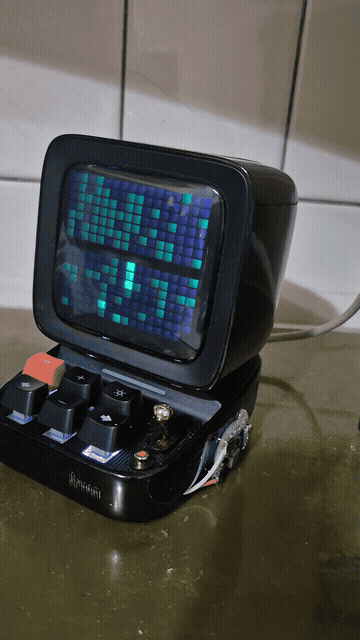
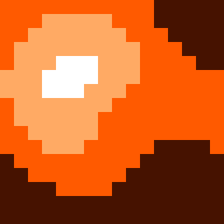
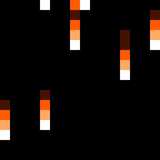
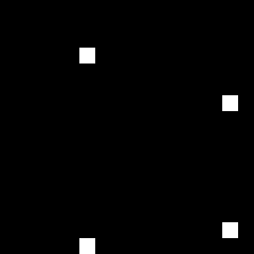
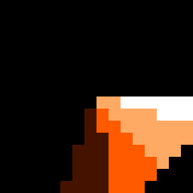

# Ditoo Pro on Linux

Drives a Divoom Ditoo Pro from a Linux desktop without the Divoom app: keeps it
connected as the Bluetooth speaker, draws on its 16×16 screen, saves pictures
into its own memory so they play with no computer attached, and shows the
GitHub contribution graph, refreshed hourly.



Sticker art converted for the screen (shown 20× up):

    

Effects redrawn in Mr Mouz orange and white:

      

## What's here

| Path | What it does |
| --- | --- |
| `bin/ditoo-screen` | The protocol: colour, brightness, clock, image/GIF, scrolling text, store to a memory slot, show a slot |
| `bin/ditoo-picture` | Any photo or GIF → 16×16 pixel art. Cuts the subject out (rembg), keeps small features like eyes alive through the shrink, optionally stores it on the speaker |
| `bin/ditoo-effects` | Orange-and-white light effects (ripple, rain, scanner, plasma, equaliser, sparkle, spin) saved into a gallery page, since the built-in VJ effects and music EQ take no colour |
| `bin/ditoo-github` | Last 32 weeks of contributions, folded into two 16-week bands; today blinks |
| `bin/ditoo-audio.sh` | Watcher that reconnects the speaker, forces the A2DP profile and makes it the default output |
| `systemd/` | User units: the audio watcher, and the hourly GitHub refresh |
| `wireplumber/` | Patched `autoswitch-bluetooth-profile.lua`; the stock one gets stuck believing it already switched to the headset profile |
| `docs/protocol.md` | What was learned about the serial protocol, including the undocumented storage upload |

## Use

```bash
ditoo-screen text "hello" 255 120 0
ditoo-screen image cat.gif
ditoo-picture photo.jpg                 # convert and show
ditoo-picture sticker.png --store 1     # convert and save into slot 1
ditoo-screen gallery 1                  # show what's in slot 1
ditoo-github

# House style: stock pictures out, Mr Mouz everywhere
ditoo-screen clear 0                    # clear a page (stock pictures go too)
ditoo-effects --store 1                 # effects into page 1
ditoo-screen boot mr_mouz.gif           # power-on animation
ditoo-screen poweron 5                  # power on to the gallery
ditoo-screen clock 0 --color 255,90,0   # orange clock
ditoo-screen color 255 90 0             # orange night light
```

## Install

```bash
./install.sh
```

Symlinks `bin/` into `~/.local/bin`, copies the units and the WirePlumber
override into place, enables the units, and builds the Python venv that
`ditoo-picture` needs at `~/.local/share/ditoo/venv`. The speaker's Bluetooth
address is `MAC` at the top of `bin/ditoo-screen` and `bin/ditoo-audio.sh`;
change both for another unit. Pair it once with `bluetoothctl` first.
`ditoo-github` needs an authenticated `gh`.

## Known gaps

- The speaker's microphone records digital silence over both mSBC and CVSD.
  Unresolved.
- How many gallery pages and files the speaker holds is unknown: it doesn't
  answer the info query. Clearing a page and replacing the boot animation are
  accepted by the speaker but were checked by eye, not by a readback.
- `ditoo-github` runs hourly and takes over the screen when it does; switch
  back with `ditoo-screen gallery 0` or disable `ditoo-github.timer`.
- Restarting WirePlumber while the speaker is connected drops A2DP and can wedge
  bluetoothd with EBUSY until it settles. Avoid it.
